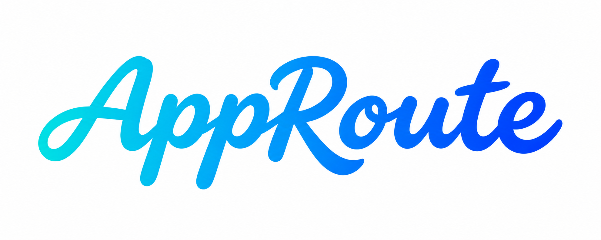
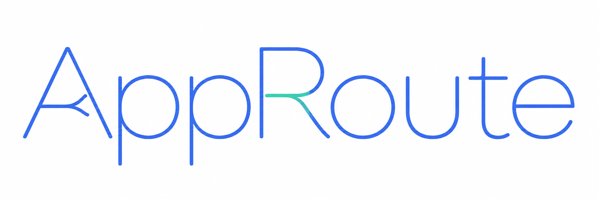
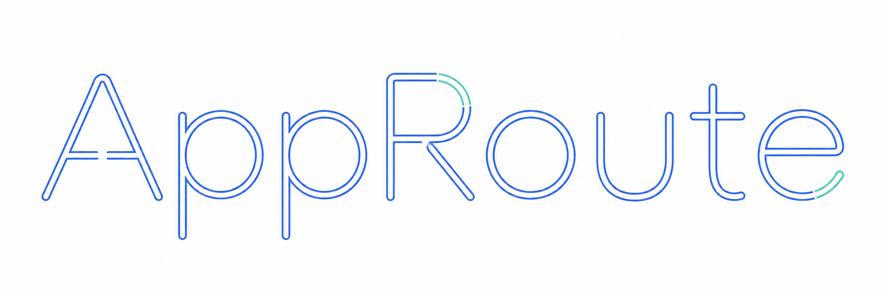
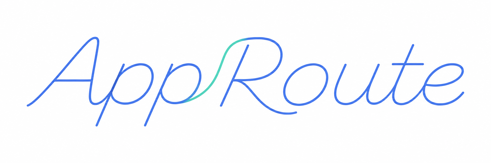

# 圆润连笔手写字标

ID：`rounded-brush-wordmark` · 版本：1.0.0 · 记录日期：2026-11-10。

基准为用户已确认的 AppRoute 稍细版。这是一种品牌字标的设计方法，不是可安装的字体文件，也不是界面正文的字体规范。

## 一句话识别

圆润、流畅、有弹性的连笔手写字标，笔画中等偏饱满，粗细自然变化，略向右倾；轻盈来自笔势与留白。

## 完整描述

> 为品牌名称设计一个圆润、流畅、有弹性的连笔手写艺术字标。采用有设计感的手写笔势：字母自然衔接，整体略向右倾，基线有轻微起伏；下行笔画适度饱满，上行和转接笔画稍细，保留清晰的粗细变化。收笔圆润，转弯顺滑，字母内部留出足够空间，避免连接处挤成一团。整体有亲和力和辨识度，笔画接近确认稿的中等饱满程度，保持轻盈又有分量。避免厚重块状字、膨胀的泡泡字、极细单线字、空心描边字和普通无衬线斜体。名称必须准确，展示时保持清晰可读。

可直接生成的完整版本与微调句子见 [PROMPTS.md](PROMPTS.md)。

## 固定特征与可调项

| 维度 | 保留的风格特征 | 可按新项目调整 |
| --- | --- | --- |
| 笔势 | 流畅手写、自然连笔、轻微右倾 | 不同名称的字母结构、连接位置 |
| 字重 | 中等偏饱满，明显的粗细变化；参照定稿视觉重量 | 小幅加粗或收细，必须检查结果 |
| 轮廓 | 圆润端点、顺滑转弯、适度留白 | 为新字母调整圈口、收笔和间距 |
| 节奏 | 连续但可辨认，略有起伏，有弹性 | 长短品牌的整体长度和排列 |
| 色彩 | 不靠阴影、立体或发光制造艺术感 | 纯色或渐变；青蓝渐变是 AppRoute 案例选择，不是强制色板 |
| 背景 | 干净、主体突出 | 白底用于看稿，透明底用于需要透明的交付 |
| 装饰 | 少量自然收笔，与文字一体 | 不必继承 AppRoute 的 A 入笔环或 R 弧线，更不必添加分流箭头 |

当前只在拉丁字母品牌名称中验证。中文书写、很长的名称、单字母标识、极小字号和深色背景需要单独设计与检查。

## 反例：为什么不选

### 厚重几何字：用户否定

粗实心块面、几何结构和挤压感较强。用户反馈“臃肿”。问题不仅是笔画粗，而是缺少手写笔势；只把它机械减细仍会偏离方向。

### 极细单线字：用户否定

把“线条感”理解成了均匀细线。用户反馈“完全是一个线条字体”。缺少饱满下行笔画和书写节奏，不能作为本风格的目标。

### 空心轮廓字：同轮未选用

双线轮廓与断口更像技术描边，缺少刷写的艺术感。不能靠描边细节替代手写字形设计。

### 细线连笔：方向接近，但未选用

用户认为第二版“偏向艺术设计一点”，随后提供了更饱满的手写参考。因此记录为部分接近的中间稿，不标作用户定稿，也不把连笔本身判为错误。

## 验收方式

先对照确认稿判断笔势、视觉重量与留白，再核对名称拼写。候选应保留圆润连笔和粗细变化；不能退回粗几何、极细单线或空心字。将图片放到实际品牌位置检查，不以大图好看代替小尺寸可读。

同一个 AppRoute 直接复用 `assets/approute-approved.png`；其 SHA-256 见 [manifest.json](manifest.json)。新名称须重新设计对应字母，不把 AppRoute 图片当作字体替换器。新名称验证见 [validation/README.md](validation/README.md)。
