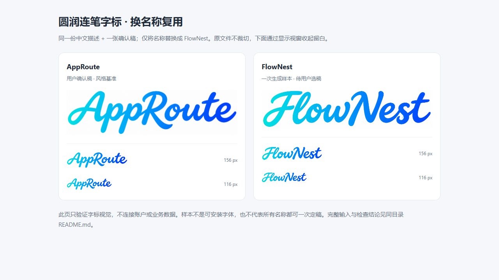

# FlowNest 换名称复用验证

日期：2026-11-10。结论：**本次一轮生成获得了接近确认稿的风格方向；FlowNest 仍是待用户选稿的验证样本。**

## 实际输入

- 工具：内置 `image_gen.imagegen`，`transparent_background: false`。没有指定或记录可复现的模型版本、随机种子。
- 提示词：从 [PROMPTS.md](../PROMPTS.md) 第一段完整中文模板直接读取，只将 `{品牌名}` 替换为 `FlowNest`，实际发送内容保存于 [prompt.zh.txt](prompt.zh.txt)。
- 正向风格参考：仅 [AppRoute 确认稿](../assets/approute-approved.png)。没有追加参考截图、反例或隐藏的英文强化提示。
- 生成次数：1；没有重试、后期重绘或挑选多张中的最好结果。
- 生成输出：`exec-ef66d169-98d6-4c40-b1b6-4add3a0a420e.png`，原文件复制为 [flownest-v1.png](flownest-v1.png)。哈希见 [manifest.json](../manifest.json)。

## 检查结果

| 检查项 | 观察结果 |
| --- | --- |
| 名称与大小写 | 可辨认为 FlowNest，F、N 为大写，没有出现旧品牌名 |
| 字形方向 | 圆润端点、自然连笔、略右倾，保留较饱满笔画及粗细变化 |
| 已否定方向 | 没有回到粗几何字、极细单线字或空心描边字 |
| 色彩与构图 | 青色到蓝色渐变、白底、单一横向字标 |
| 156 / 116 像素宽度 | 在 [独立对照页](preview.html) 实际浏览，两档仍可辨认；DOM 核对宽度与设定一致，截图见上图 |
| 页面加载 | 对照页无控制台错误；1280 像素视口没有横向溢出 |
| 仍可精修 | F、N 的视觉占比更突出；大图中 s 下部内圈有轻微浅色痕迹。正式选用时可定点修整，不把本次风格检查当成最终品牌验收 |

这里的结果是 Agent 对这一轮图像和静态展示的检查，不是独立盲测、用户确认、商标核验或完整字体测试。没有验证无参考图的纯文字生成、不同生成器、中文名称、深色背景或多次重复生成的一致性。

## 复现与维护

下一次先读取同一版本风格卡、正反例与模板，再换名称生成；不要因为这次一轮接近就省略拼写与实际尺寸检查。同品牌延续直接使用确认文件，不重复生成。

`preview.html` 是仅依赖本目录图片的静态对照页，不是 Gallery 新栏目。可直接打开，也可通过本机静态服务器查看。布局只改变图片的显示视窗与大小，原 PNG 未裁切或改画。
